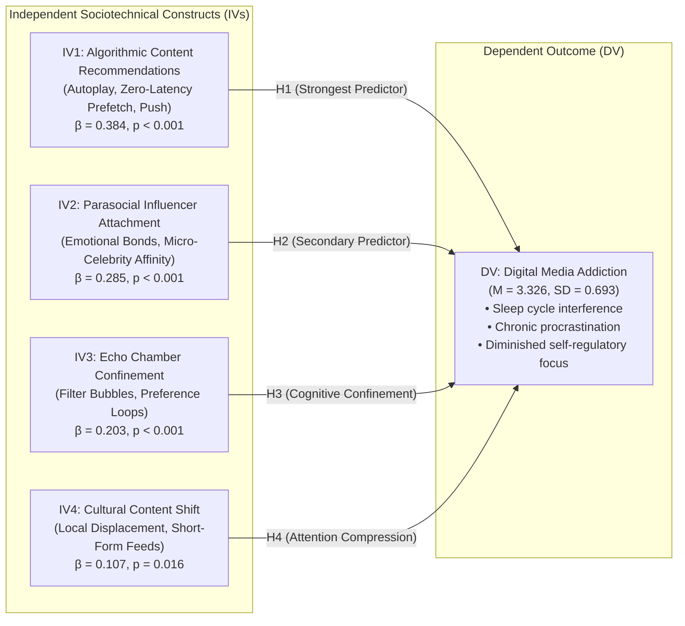

# The Impact of Algorithmic Social Media on Digital Media Addiction
### An Empirical Sociotechnical Investigation in Statistics for Computing

[](https://www.nibm.lk/)
[](https://www.nibm.lk/)
[]()
[]()
[]()
[]()

---

## 📌 Executive Overview

In the modern digital landscape, social media platforms have undergone a paradigm shift—transitioning from voluntary, user-initiated **"pull" models** (such as explicit searches and static RSS/chronological feeds) to involuntary, platform-driven **"push" models** governed by deep neural networks, matrix factorization algorithms, collaborative filtering, and continuous client-side telemetry. 

This repository hosts the complete empirical research project, raw dataset ($N=322$), SPSS transformation matrices, analytical syntax, output documents, and the formal 32-page academic report titled:
> **"The Impact of Algorithmic Social Media on Digital Media Addiction"**  
> *Conducted under the School of Computing & Engineering, National Institute of Business Management (NIBM), Colombo, Sri Lanka.*

Through rigorous parametric and non-parametric statistical procedures executed in **IBM SPSS Statistics 27**, this study constructs an ordinary least squares (**OLS**) multiple linear regression model explaining **51.8% of the variance** in digital media addiction ($R^2 = 0.518, F(4, 317) = 85.009, p < 0.001$). The findings substantiate that modern digital addiction is fundamentally an engineered architectural phenomenon driven by automated recommendation engines and parasocial creator attachment, rather than merely an intrinsic deficit in individual self-regulation.

---

## 👥 Authors & Academic Credentials

| Name | Student Registration ID | Institution / Department |
| :--- | :--- | :--- |
| **K.G.L. Sandanimne** | `COHNDSE26.1F-004` | School of Computing & Engineering, NIBM |
| **D.D. Kandeepan** | `COHNDSE26.1F-28` | School of Computing & Engineering, NIBM |
| **M.V.U. Perera** | `COHNDSE26.1F-51` | School of Computing & Engineering, NIBM |

- **Programme:** Higher Diploma in Software Engineering (HDSE 26.1F)
- **Module:** Statistics for Computing
- **Repository:** [https://github.com/NimnaOfficial/StatisticsForComputing](https://github.com/NimnaOfficial/StatisticsForComputing)

---

## 📑 Table of Contents

1. [Theoretical Framework & Conceptual Model](#-theoretical-framework--conceptual-model)
2. [Research Objectives & Hypotheses](#-research-objectives--hypotheses)
3. [Research Methodology & Operationalization](#-research-methodology--operationalization)
   - [Target Population & Inclusion Criteria](#target-population--inclusion-criteria)
   - [Survey Instrument Architecture](#survey-instrument-architecture)
   - [Data Hygiene, Verification & Ingestion](#data-hygiene-verification--ingestion)
4. [Empirical Results & Statistical Analysis](#-empirical-results--statistical-analysis)
   - [Construct Descriptive Statistics](#1-descriptive-statistics-of-evaluated-constructs)
   - [Demographic Profiling & Behavioral Telemetry](#2-demographic-profiling--behavioral-telemetry)
   - [Hypothesis 1: Pearson Chi-Square Test of Independence](#3-hypothesis-testing-chi-square-test-of-independence)
   - [Hypothesis 2: One-Way ANOVA (Age Invariance)](#4-hypothesis-testing-one-way-anova-age-invariance)
   - [Hypothesis 3: Pearson Bivariate Correlation Matrix](#5-bivariate-relationships-pearson-correlation-matrix)
   - [Hypothesis 4: Multiple Linear Regression Model](#6-predictive-modeling-multiple-linear-regression-analysis)
5. [Key Empirical Insights & Synthesis](#-key-empirical-insights--synthesis)
6. [Multi-Tiered Mitigation Framework for Computing](#-multi-tiered-mitigation-framework-for-computing)
7. [Repository File Catalog](#-repository-file-catalog)
8. [Replication Guide](#-replication-guide)
9. [References & Academic Attribution](#-references--academic-attribution)

---

## 🧠 Theoretical Framework & Conceptual Model

The conceptual foundation connects established sociological and behavioral psychological paradigms with cutting-edge software architecture:



### Theoretical Foundations
1. **Skinner's Operant Conditioning (Variable-Ratio Reinforcement):**  
   Modern feeds utilize stochastic reward delivery analogous to digital slot machines. Every downward swipe acts as a lever pull with variable reward schedules, stimulating dopamine pathways and triggering unconscious compulsion loops.
2. **Media System Dependency (MSD) Theory (Ball-Rokeach & DeFleur, 1976):**  
   As individuals increasingly rely on algorithmic feeds for social identity, entertainment, and current events, systemic cognitive dependence deepens, escalating switching costs and triggering fear-of-missing-out (FOMO).
3. **Algorithmic Filter Bubbles & Collaborative Filtering (Pariser, 2011; Sunstein, 2017):**  
   K-nearest neighbor (k-NN) and neural matrix factorization cluster users into homophilous informational niches, decreasing cognitive friction and reinforcing cognitive bias to prolong session duration.
4. **Parasocial Interaction Theory (Horton & Wohl, 1956):**  
   Algorithmic recommendation pipelines curate continuous micro-video feeds of niche influencers, forging perceived reciprocal intimacy and transforming casual browsing into an obligation-driven routine.

---

## 🎯 Research Objectives & Hypotheses

### Primary Objectives
- **Objective 1:** Quantify the predictive impact of automated content pipelines (infinite scroll, autoplay, background pre-fetching, push notifications) on subjective digital media addiction.
- **Objective 2:** Investigate the role of algorithmic parasocial interaction with content creators in driving platform dependency.
- **Objective 3:** Assess how algorithmic echo chambers and personalization feedback loops retain users and accelerate cognitive absorption.
- **Objective 4:** Measure the effect of algorithmic cultural displacement (short-form global content supplanting domestic programming) on screen-time inflation.
- **Objective 5:** Formulate a validated multiple linear regression model ($Y = f(X_1, X_2, X_3, X_4)$) to quantify relative predictor weights.

### Hypotheses Formulation
- **$H_1$:** Algorithmic content recommendation mechanisms exert a statistically significant positive effect on digital media addiction. *(Supported)*
- **$H_2$:** Parasocial influencer attachment exerts a statistically significant positive effect on digital media addiction. *(Supported)*
- **$H_3$:** Algorithmic echo chamber confinement exerts a statistically significant positive effect on digital media addiction. *(Supported)*
- **$H_4$:** Cultural content shift induced by algorithms exerts a statistically significant positive effect on digital media addiction. *(Supported)*

---

## 🔬 Research Methodology & Operationalization

### Target Population & Inclusion Criteria
The target population comprised digital media consumers aged **18 to 40 years** residing in Sri Lanka.
- **Inclusion Criteria:** (1) Age 18–40; (2) Daily active engagement with at least one algorithmic video platform (TikTok, YouTube, Instagram, Facebook); (3) English-language survey comprehension.
- **Exclusion Criteria:** (1) Age $< 18$ or $> 40$; (2) Incomplete responses or bot submissions.
- **Sampling Strategy:** Non-probability purposive and digital snowball sampling deployed across undergraduate university cohorts (NIBM, government and private universities), IT software engineering firms, and youth professional networks.

### Survey Instrument Architecture
The empirical intake instrument consisted of **30 structured items** across 6 standardized sections:

| Section | Focus Construct / Domain | Measurement Items | Scale Type |
| :--- | :--- | :--- | :--- |
| **Section 1** | Demographic & Platform Profiling | Q1.1 – Q1.5 | Categorical / Nominal |
| **Section 2** | Algorithmic Content Recommendations (`IV1_Algo`) | Q2.6 – Q2.10 | 5-point Likert (1=Never to 5=Always) |
| **Section 3** | Parasocial Influencer Attachment (`IV2_Influencer`) | Q3.11 – Q3.15 | 5-point Likert (1=Strongly Disagree to 5=Strongly Agree) |
| **Section 4** | Echo Chambers & Personalization (`IV3_Echo`) | Q4.16 – Q4.20 | 5-point Likert (1=Strongly Disagree to 5=Strongly Agree) |
| **Section 5** | Cultural Content Shift (`IV4_Culture`) | Q5.21 – Q5.25 | 5-point Likert (1=Strongly Disagree to 5=Strongly Agree) |
| **Section 6** | Addiction Markers & Behavioral Telemetry (`DV_Addiction`) | Q6.26 – Q6.30 | Exact Daily Hours (Ratio), Bedtime Habit (Binary), Likert (3 items) |

Composite factor scores were mathematically computed via the arithmetic mean:
$$\text{Factor Composite} = \frac{1}{k}\sum_{i=1}^k X_i$$
*(where $k=5$ for independent variables $IV_1$ through $IV_4$, and $k=3$ for dependent construct $DV$).*

### Data Hygiene, Verification & Ingestion
- **Sample Power Requirement:** Coursework minimum threshold was $N \ge 250$. Final verified sample reached **$N = 322$** ($+28.8\%$ over target), providing statistical power $(1 - \beta) > 0.95$ at $\alpha = 0.05$.
- **Ingestion Validation:** Google OAuth single-token authentication was enforced to eliminate duplicate submissions. Mandatory form validation yielded **0.0% missing data** across all 322 cases.
- **Data Transformation Pipeline:** Raw spreadsheet exported to `SC_CW_dataset.xlsx`, encoded into IBM SPSS `SC_CW_analyse.sav`, recoded via `AUTORECODE` for string-to-numeric conversions, and validated through `SC_CW_syntax.sps`.

---

## 📊 Empirical Results & Statistical Analysis

### 1. Descriptive Statistics of Evaluated Constructs

Summary of central tendency, dispersion, and observed parametric bounds across all evaluated factors ($N = 322$):

| Construct Variable | Operational Metric | Min | Max | Mean ($\mu$) | Std. Deviation ($\sigma$) |
| :--- | :--- | :---: | :---: | :---: | :---: |
| **IV1_Algo** | Algorithmic Content Distribution | 1.40 | 4.80 | **3.3248** | 0.71839 |
| **IV2_Influencer** | Parasocial Influencer Attachment | 1.60 | 5.00 | **3.5224** | 0.76712 |
| **IV3_Echo** | Echo Chamber Confinement | 1.00 | 5.00 | **3.0553** | 0.73424 |
| **IV4_Culture** | Cultural Content Displacement | 1.40 | 4.80 | **3.2758** | 0.71858 |
| **DV_Addiction** | Digital Media Addiction | 1.00 | 5.00 | **3.3261** | 0.69285 |

> **Key Observation:** `IV2_Influencer` yielded the highest single agreement ($\mu = 3.5224$), proving that modern recommendation algorithms are exceptionally potent at fostering perceived emotional intimacy with creators.

---

### 2. Demographic Profiling & Behavioral Telemetry

Distribution of demographic indicators and behavioral habits across the sample ($N = 322$):

| Category | Stratification | Frequency ($n$) | Percentage (%) |
| :--- | :--- | :---: | :---: |
| **Age Distribution** | 18 – 24 years | 186 | 57.76% |
| | 25 – 30 years | 124 | 38.51% |
| | 31 – 40 years | 12 | 3.73% |
| **Gender Identity** | Female | 159 | 49.38% |
| | Male | 152 | 47.20% |
| | Prefer not to say | 11 | 3.42% |
| **Employment Status** | Full/Part-time Employed | 122 | 37.89% |
| | Student | 126 | 39.13% |
| | Self-Employed / Freelance | 44 | 13.66% |
| | Unemployed | 30 | 9.32% |
| **Language Preference**| Bilingual English/Sinhala/Tamil Mix | 121 | 37.58% |
| | Sinhala | 116 | 36.02% |
| | English | 59 | 18.32% |
| | Tamil | 26 | 8.07% |
| **Primary Platform** | **TikTok** | **124** | **38.51%** |
| | **YouTube** | **103** | **31.99%** |
| | **Instagram** | **74** | **22.98%** |
| | **Facebook** | **21** | **6.52%** |

#### Behavioral Telemetry Highlights
- **Bedtime & Awakening Dependency (Q6.27):** **56.52%** ($n = 182$) report compulsively accessing social feeds within 30 minutes of waking up or immediately before sleeping.
- **Daily Entertainment Screen Time (Q6.26):** Participants report an average of **4.57 hours/day** ($SD = 1.50$, range: 0.50 – 8.60 hours) devoted strictly to leisure digital entertainment.

---

### 3. Hypothesis Testing: Chi-Square Test of Independence
**Test:** Association between User Gender (Q1.2) and Preferred Media Platform (Q1.5).

```
Crosstabulation Matrix (Count):
Platform        Female    Male    Prefer not to say    Total
------------------------------------------------------------
Facebook          16        5            0              21
Instagram         43       30            1              74
TikTok            51       68            5             124
YouTube           49       49            5             103
------------------------------------------------------------
Total            159      152           11             322
```

| Test Metric | Value | Degrees of Freedom ($df$) | Asymptotic Sig. (2-sided) | Significance Status |
| :--- | :---: | :---: | :---: | :---: |
| **Pearson Chi-Square ($\chi^2$)** | **13.044** | **6** | **0.042** | **Statistically Significant ($p < 0.05$)** |
| **Likelihood Ratio** | 14.068 | 6 | 0.029 | Statistically Significant ($p < 0.05$) |
| **Valid Cases ($N$)** | 322 | — | — | — |

- **Interpretation:** We reject the null hypothesis ($p = 0.042 < 0.05$). Gender identity significantly influences platform preference. Male users exhibited greater affinity for TikTok ($n=68$ vs $n=51$), whereas female users exhibited higher adoption of visual curation platforms such as Instagram ($n=43$ vs $n=30$) and Facebook ($n=16$ vs $n=5$). YouTube showed identical distribution across binary genders ($n=49$ each).

---

### 4. Hypothesis Testing: One-Way ANOVA (Age Invariance)
**Test:** Differences in Digital Media Addiction (`DV_Addiction`) across Age Brackets (`Age_Numeric`).

```
Group Breakdown:
Cohort          N        Mean      Std. Dev.     Std. Error    95% CI [Lower, Upper]
------------------------------------------------------------------------------------
18 – 24        186      3.3889      0.68788        0.05044        [3.2894, 3.4884]
25 – 30        124      3.2124      0.69497        0.06241        [3.0888, 3.3359]
31 – 40         12      3.5278      0.62697        0.18099        [3.1294, 3.9261]
------------------------------------------------------------------------------------
Total          322      3.3261      0.69285        0.03861        [3.2501, 3.4020]
```

| Source of Variation | Sum of Squares ($SS$) | $df$ | Mean Square ($MS$) | $F$-Statistic | Significance ($p$) |
| :--- | :---: | :---: | :---: | :---: | :---: |
| **Between Groups** | 2.825 | 2 | 1.413 | **2.979** | **0.052** |
| **Within Groups** | 151.269 | 319 | 0.474 | — | — |
| **Total** | 154.094 | 321 | — | — | — |

- **Interpretation:** At the strict $\alpha = 0.05$ threshold, the difference is marginally non-significant ($F(2, 319) = 2.979, p = 0.052 > 0.05$). This critical empirical finding demonstrates **age ubiquity**: algorithmic addiction is not isolated to young undergraduates (18–24), but equally permeates working professionals and older adults (25–40).

---

### 5. Bivariate Relationships: Pearson Correlation Matrix

Two-tailed Pearson correlation matrix measuring bivariate relationships between constructs ($N = 322$):

| Variable | IV1_Algo | IV2_Influencer | IV3_Echo | IV4_Culture | DV_Addiction |
| :--- | :---: | :---: | :---: | :---: | :---: |
| **IV1_Algo** | 1.000 | 0.273\*\* | 0.440\*\* | 0.318\*\* | **0.585\*\*** |
| **IV2_Influencer** | 0.273\*\* | 1.000 | 0.388\*\* | 0.314\*\* | **0.502\*\*** |
| **IV3_Echo** | 0.440\*\* | 0.388\*\* | 1.000 | 0.422\*\* | **0.527\*\*** |
| **IV4_Culture** | 0.318\*\* | 0.314\*\* | 0.422\*\* | 1.000 | **0.404\*\*** |
| **DV_Addiction** | **0.585\*\*** | **0.502\*\*** | **0.527\*\*** | **0.404\*\*** | 1.000 |

*\*\* Correlation is statistically significant at the 0.01 level (2-tailed, $p < 0.001$).*

- **Multicollinearity Diagnostic:** All predictor intercorrelations ($r = 0.273$ to $0.440$) fall safely below the conservative $r = 0.70$ threshold, confirming absence of collinearity distortion.

---

### 6. Predictive Modeling: Multiple Linear Regression Analysis

An Ordinary Least Squares (OLS) Multiple Linear Regression with standard `ENTER` selection was executed:
- **Predictors:** `(Constant)`, `IV1_Algo`, `IV2_Influencer`, `IV3_Echo`, `IV4_Culture`
- **Dependent Variable:** `DV_Addiction`

#### Model Summary
| Model | Correlation ($R$) | Coefficient of Determination ($R^2$) | Adjusted $R^2$ | Std. Error of Estimate |
| :---: | :---: | :---: | :---: | :---: |
| **1** | **0.719** | **0.518** | **0.511** | **0.48428** |

#### ANOVA Model Significance
| Source of Variance | Sum of Squares ($SS$) | $df$ | Mean Square ($MS$) | Omnibus $F$ | Significance ($p$) |
| :--- | :---: | :---: | :---: | :---: | :---: |
| **Regression** | 79.748 | 4 | 19.937 | **85.009** | **< 0.001** |
| **Residual** | 74.346 | 317 | 0.235 | — | — |
| **Total** | 154.094 | 321 | — | — | — |

#### Regression Parameter Coefficients
| Parameter | Unstandardized $B$ | Std. Error | Standardized Beta ($\beta$) | $t$-statistic | Sig. ($p$) | Empirical Verdict |
| :--- | :---: | :---: | :---: | :---: | :---: | :---: |
| **(Constant)** | 0.267 | 0.173 | — | 1.541 | 0.124 | Baseline intercept |
| **IV1_Algo** | **0.370** | **0.043** | **0.384** | **8.673** | **< 0.001** | **$H_1$ Supported (Strongest)** |
| **IV2_Influencer** | **0.258** | **0.039** | **0.285** | **6.599** | **< 0.001** | **$H_2$ Supported** |
| **IV3_Echo** | **0.191** | **0.045** | **0.203** | **4.264** | **< 0.001** | **$H_3$ Supported** |
| **IV4_Culture** | **0.103** | **0.043** | **0.107** | **2.416** | **0.016** | **$H_4$ Supported** |

#### Derived Empirical Regression Equation
$$\hat{Y}_{\text{Addiction}} = 0.267 + 0.370(X_{\text{Algo}}) + 0.258(X_{\text{Influencer}}) + 0.191(X_{\text{Echo}}) + 0.103(X_{\text{Culture}})$$

---

## 💡 Key Empirical Insights & Synthesis

1. **Algorithmic Primacy ($\beta = 0.384, p < 0.001$):**  
   Algorithmic distribution features (infinite scroll, auto-prefetching, autoplay, and automated notification hooks) represent the single strongest driver of digital addiction. Every unit increase in algorithmic exposure elevates addiction severity by $0.370$ points.
2. **Parasocial Bond Leverage ($\beta = 0.285, p < 0.001$):**  
   Rather than serving random viral clips, modern algorithms match niche creators to individual psychological profiles. This creates pseudo-intimate parasocial connections that convert leisure viewing into habitual social duty.
3. **Filter Bubble Inertia ($\beta = 0.203, p < 0.001$):**  
   Recommendation engines reinforce ideological echo chambers, shielding users from contrasting views. This minimization of cognitive friction encourages extended session duration.
4. **Attention Economy Variance ($R^2 = 0.518$):**  
   Over half (51.8%) of the total variance in digital media addiction is directly explained by these four algorithmic mechanics alone. The remaining 48.2% is attributed to external variables (e.g., neurobiology, environmental stressors, individual attachment styles).

---

## 🛠️ Multi-Tiered Mitigation Framework for Computing

To counteract algorithmic addiction without dismantling platform utility, this study proposes a three-tier mitigation architecture:

| Tier | Intervention Level | Specific Mechanism & Implementation |
| :--- | :--- | :--- |
| **Tier 1** | **Software Architecture & UI/UX** | • **Ethical Friction Design:** Replace infinite scroll with paginated feeds or mandatory session pauses after 30 continuous minutes.<br>• **Opt-In Autoplay:** Disable client-side video autoplay by default; require deliberate user touch events.<br>• **Algorithmic Dials:** Expose transparent user controls to toggle recommendation diversity (Exploration vs. Exploitation balance).<br>• **OS Rate-Limiting:** Implement system-level notification batching budgets on mobile operating systems. |
| **Tier 2** | **Organizational & Institutional** | • **Asynchronous Work Norms:** Mandate asynchronous communication across engineering and corporate teams.<br>• **Notification Blackouts:** Implement technical bans on internal messaging/email pings outside standard business hours to preserve cognitive recovery.<br>• **Digital Wellbeing Programs:** Integrate screen-time mindfulness in university curricula and corporate health plans. |
| **Tier 3** | **Individual Behavioral Sanity** | • **Display Sanitization:** Enable monochromatic grayscale modes on mobile devices at dusk to reduce dopamine triggers.<br>• **Algorithmic Cache Reset:** Periodically reset Mobile Advertising IDs (IDFA/GAID) and purge app cache to disrupt hyper-personalized feedback loops.<br>• **Physical Device Separation:** Place device chargers outside the bedroom to prevent bedtime/morning screen dependency. |

---

## 📂 Repository File Catalog

```
├── FINAL_SC_REPORT.pdf      # Complete 32-page submitted academic research publication report
├── README.md                # Comprehensive project documentation, statistical analysis & synthesis
├── SC_CW_Report.docx        # Working manuscript draft of the research report (Microsoft Word)
├── SC_CW_analyse.sav        # Master IBM SPSS 27 dataset with computed factor variables & recoded scales
├── SC_CW_dataset.xlsx       # Raw intake survey data matrix (N=322, 30 questionnaire items)
├── SC_CW_outputs.spv        # Native IBM SPSS Viewer binary output file with generated charts/tables
├── SC_CW_spssouts.docx      # Formatted SPSS statistical tables exported to Word
└── SC_CW_syntax.sps         # Complete SPSS production syntax script for reproducing all analyses
```

### Detailed File Descriptions
- [FINAL_SC_REPORT.pdf](FINAL_SC_REPORT.pdf): The official 32-page submitted coursework report containing the complete literature review, conceptual model diagrams, questionnaire schedule, full SPSS tables, discussion, and 22 APA references.
- [SC_CW_dataset.xlsx](SC_CW_dataset.xlsx): Cleaned raw data matrix containing all 322 survey entries collected via Google Forms.
- [SC_CW_analyse.sav](SC_CW_analyse.sav): IBM SPSS Statistics data file containing all 30 survey variables, variable labels, numeric autorecode transformations, and composite compute targets (`IV1_Algo`, `IV2_Influencer`, `IV3_Echo`, `IV4_Culture`, `DV_Addiction`).
- [SC_CW_syntax.sps](SC_CW_syntax.sps): SPSS syntax file with commands for `DESCRIPTIVES`, `CROSSTABS` (Chi-Square), `ONEWAY` (ANOVA), and `FREQUENCIES`.
- [SC_CW_outputs.spv](SC_CW_outputs.spv): Native SPSS output file storing the full session tree, statistics logs, crosstabulations, and regression models.
- [SC_CW_spssouts.docx](SC_CW_spssouts.docx): Documented statistical outputs with 21 formatted tables extracted from the SPSS session.
- [SC_CW_Report.docx](SC_CW_Report.docx): Editable Microsoft Word working draft of the complete research paper.

---

## 🔁 Replication Guide

### Option A: Executing via IBM SPSS Statistics (Version 25+)
1. Launch **IBM SPSS Statistics**.
2. Open the dataset: `File` $\to$ `Open` $\to$ `Data...` $\to$ select `SC_CW_analyse.sav`.
3. Open the syntax file: `File` $\to$ `Open` $\to$ `Syntax...` $\to$ select `SC_CW_syntax.sps`.
4. Run the entire script: Select `Run` $\to$ `All` (or press `Ctrl+A` then `Ctrl+R`).
5. To execute the Multiple Linear Regression model:
   ```spss
   REGRESSION
     /MISSING LISTWISE
     /STATISTICS COEFF OUTS R ANOVA
     /CRITERIA=PIN(.05) POUT(.10)
     /NOORIGIN 
     /DEPENDENT DV_Addiction
     /METHOD=ENTER IV1_Algo IV2_Influencer IV3_Echo IV4_Culture.
   ```

### Option B: Replication via Python (Pandas & Statsmodels)
You can replicate the exact OLS regression results using Python:

```python
import pandas as pd
import statsmodels.api as sm

# Read dataset (using Excel source or PyReadStat with .sav)
df = pd.read_excel('SC_CW_dataset.xlsx')

# Compute continuous factor composite scores
# IV1 (Q2.6 - Q2.10), IV2 (Q3.11 - Q3.15), IV3 (Q4.16 - Q4.20), IV4 (Q5.21 - Q5.25)
# DV (Q6.28 - Q6.30)
iv1 = df.iloc[:, 5:10].mean(axis=1)
iv2 = df.iloc[:, 10:15].mean(axis=1)
iv3 = df.iloc[:, 15:20].mean(axis=1)
iv4 = df.iloc[:, 20:25].mean(axis=1)
dv = df.iloc[:, 27:30].mean(axis=1)

X = pd.DataFrame({'IV1_Algo': iv1, 'IV2_Influencer': iv2, 'IV3_Echo': iv3, 'IV4_Culture': iv4})
X = sm.add_constant(X)
y = dv

model = sm.OLS(y, X).fit()
print(model.summary())
```

---

## 📚 References & Academic Attribution

- Alter, A. (2017). *Irresistible: The rise of addictive technology and the business of keeping us hooked*. Penguin Press.
- Ball-Rokeach, S. J., & DeFleur, M. L. (1976). A dependency model of mass-media effects. *Communication Research*, 3(1), 3-21.
- Bandura, A. (1986). *Social foundations of thought and action: A social cognitive theory*. Prentice-Hall.
- Bányai, F., et al. (2017). Problematic Social Media Use: Results from a Large-Scale Nationally Representative Adolescent Sample. *PLoS ONE*, 12(1), e0169839.
- Bhargava, V. R., & Velasquez, M. (2021). Ethics of the Attention Economy: The Problem of Social Media Addiction. *Business Ethics Quarterly*, 31(3), 321-359.
- Bruns, A. (2019). *Are Filter Bubbles Real?* Polity Press.
- Burr, C., Cristianini, N., & Ladyman, J. (2018). An analysis of the interaction between intelligent software agents and human users. *Minds and Machines*, 28(4), 735-774.
- Eyal, N. (2014). *Hooked: How to Build Habit-Forming Products*. Portfolio/Penguin.
- Field, A. (2018). *Discovering Statistics Using IBM SPSS Statistics* (5th ed.). SAGE Publications.
- Hair, J. F., Black, W. C., Babin, B. J., & Anderson, R. E. (2019). *Multivariate Data Analysis* (8th ed.). Cengage.
- Horton, D., & Wohl, R. R. (1956). Mass Communication and Para-social Interaction. *Psychiatry*, 19(3), 215-229.
- Kuss, D. J., & Griffiths, M. D. (2017). Social networking sites and addiction: Ten lessons learned. *IJERPH*, 14(3), 311.
- Montag, C., et al. (2019). Smartphone Addiction and the Need for a New UI/UX Design Ethics. *Frontiers in Psychology*, 10, 2582.
- Narayanan, A., et al. (2020). Understanding social media recommendation algorithms. *Communications of the ACM*, 63(9), 42-49.
- Pariser, E. (2011). *The Filter Bubble: What the Internet Is Hiding from You*. Penguin Press.
- Skinner, B. F. (1953). *Science and Human Behavior*. Macmillan.
- Sunstein, C. R. (2017). *#Republic: Divided Democracy in the Age of Social Media*. Princeton University Press.
- Tufekci, Z. (2018). YouTube, the Great Radicalizer. *The New York Times*.
- Yeung, K. (2017). 'Hypernudge': Big data as a mode of regulation by design. *Information, Communication & Society*, 20(1), 118-136.

---

### Academic Citation
If referencing this research or utilizing the dataset, please cite as:
```bibtex
@techreport{sandanimne2026algorithmicaddiction,
  author      = {Sandanimne, K. G. L. and Kandeepan, D. D. and Perera, M. V. U.},
  title       = {The Impact of Algorithmic Social Media on Digital Media Addiction},
  institution = {National Institute of Business Management (NIBM), School of Computing \& Engineering},
  year        = {2026},
  type        = {Coursework Research Report},
  url         = {https://github.com/NimnaOfficial/StatisticsForComputing}
}
```
